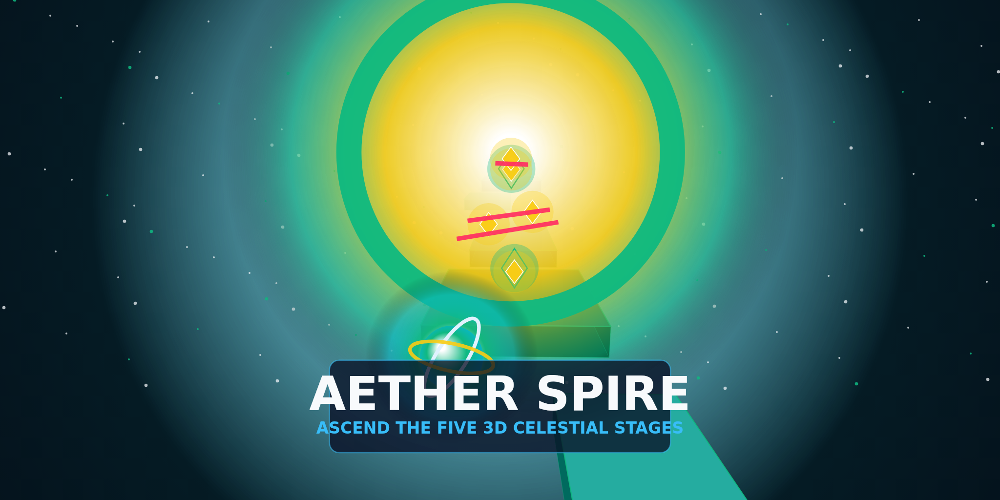

# Aether Spire

## Ascend five 3D sky stages.

Roll, double-jump, and dash a luminous sphere across five 3D stages. Every checkpoint, shard, and stage unlock saves automatically so you carry on right where you left off.

---

Welcome to **Aether Spire**, an original 3D action-platformer built for Arcadible. Pilot the **Aether Sphere** through a vertical gauntlet of five handcrafted 3D stages suspended in deep space, featuring moving void ferries, high-velocity boost conduits, rotating plasma beams, and glowing Aether Shards.

### Five Handcrafted 3D Stages

1. **Stage 1 — Prism Causeway:** Awaken the Aether Sphere, master aerial double-jumps and pulse dashes, and cross oscillating sky-bridges to the Resonance Warp Gate.
2. **Stage 2 — Kinetic Foundry:** Time rotating pendulum sweepers and launch across chasm gaps on high-velocity boost conduits.
3. **Stage 3 — Laser Sanctum:** Weave between counter-rotating plasma beams, angled launch pads, and elevated emerald relays.
4. **Stage 4 — Orbital Conduit:** Ride cross-axis void ferries and chain vertical boost rings high above the abyss.
5. **Stage 5 — Crown of the Spire:** Conquer the final celestial gauntlet and ignite the Apex Core at the summit.

### Seamless Progress with Arcadible Saves

- **Carry On Where You Left Off:** Every time you activate a **Checkpoint Beacon**, collect an **Aether Shard**, or enter a **Warp Portal** to clear a stage, your exact stage, checkpoint position, unlocked stages, star ratings, and best times are saved with Arcadible Saves.
- **Cross-Update and Multi-Tab Safe:** Progress carries forward automatically across game updates, merges unlocked stages safely across tabs, and pauses and saves automatically whenever the game is backgrounded.

### Controls

- **Keyboard:** W, A, S, D or Arrow Keys to roll, Space to jump and double-jump, Shift or E to pulse dash, R to respawn at checkpoint, P or Escape for Stage Select, 1 to 5 to jump to unlocked stages.
- **Mouse:** Drag to orbit the 3D camera and use the top HUD buttons for Stage Select and Audio.
- **Gamepad:** Left Stick to move, Right Stick to orbit camera, South button to jump, East or West button to dash, Start for Stage Select.
- **Touch:** Virtual left joystick to steer and dedicated JUMP and DASH buttons on the right.

---

## Development

Built with [Three.js](https://threejs.org/) and [@arcadible/sdk](https://developer.arcadible.com/references/arcadible-sdk).
